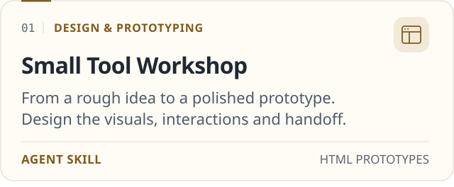
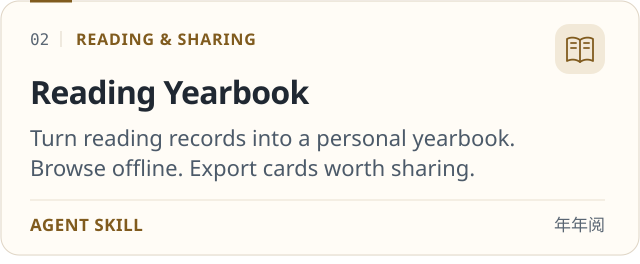
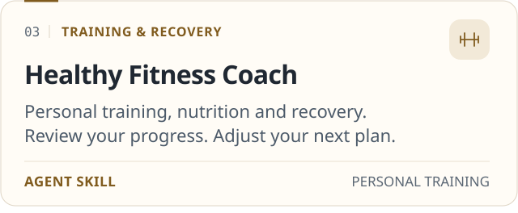
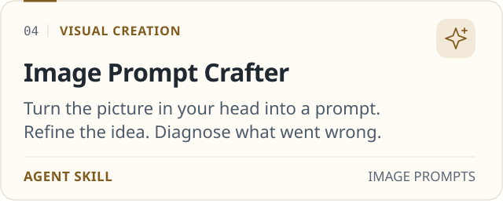
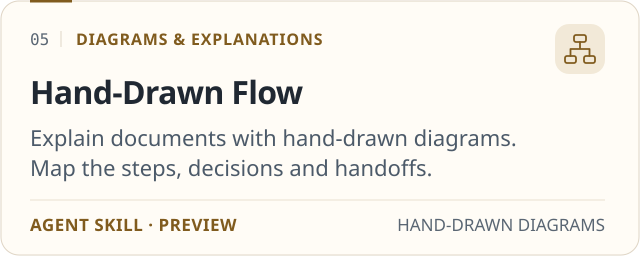
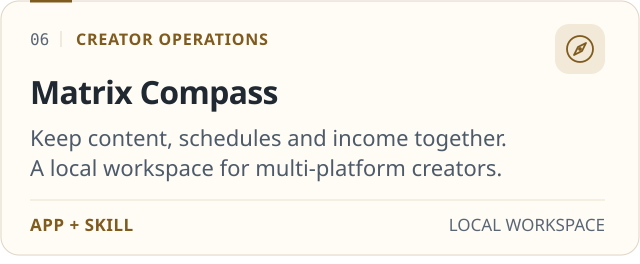
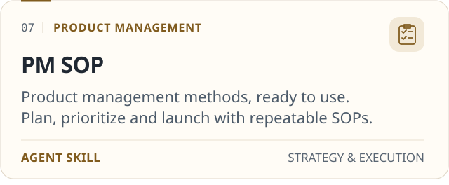
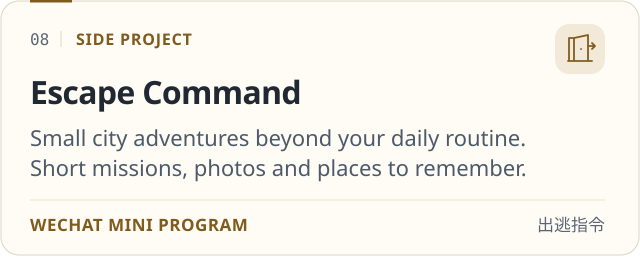

<strong>🧭 Product Manager</strong> · AI Enthusiast · Tech Idealist

📍 base Guangzhou/Shenzhen

  
  
  
  
  

---

### 🧠 About Me

- 🧭 Working Product Manager with deep industry insight
- 🤖 AI industry practitioner with rich research experience · Vibe Coding master
- 📝 Writing enthusiast — sharing product thinking & AI in practice
- ☕ Coffee-driven PM — no coffee, no good PRD
- 🎯 Never stop, infinite progress

<!-- 💡 Want to add more? e.g. company / school / currently learning / ask me about ... -->

---

### 🚀 Building

Reusable AI skills and small products for work, creativity and everyday life.

<!-- Each card links to its repository. Fixed-width images wrap on narrow screens.
     Regenerate both themes with: python scripts/generate-project-cards.py -->

  <a href="https://github.com/Surge-Dan/small-tool-design-workshop"><picture><source media="(prefers-color-scheme: dark)" srcset="assets/projects/small-tool-workshop-dark.svg" /></picture></a>
  <a href="https://github.com/Surge-Dan/reading-book-skill"><picture><source media="(prefers-color-scheme: dark)" srcset="assets/projects/reading-yearbook-dark.svg" /></picture></a>
  <a href="https://github.com/Surge-Dan/healthy-fitness-coach-skill"><picture><source media="(prefers-color-scheme: dark)" srcset="assets/projects/fitness-coach-dark.svg" /></picture></a>
  <a href="https://github.com/Surge-Dan/image-prompt-crafter-skill"><picture><source media="(prefers-color-scheme: dark)" srcset="assets/projects/image-prompt-crafter-dark.svg" /></picture></a>
  <a href="https://github.com/Surge-Dan/hand-drawn-flow-skill"><picture><source media="(prefers-color-scheme: dark)" srcset="assets/projects/hand-drawn-flow-dark.svg" /></picture></a>
  <a href="https://github.com/Surge-Dan/matrix-compass-skill"><picture><source media="(prefers-color-scheme: dark)" srcset="assets/projects/matrix-compass-dark.svg" /></picture></a>
  <a href="https://github.com/Surge-Dan/pm-sop-skill"><picture><source media="(prefers-color-scheme: dark)" srcset="assets/projects/pm-sop-dark.svg" /></picture></a>
  <a href="https://github.com/Surge-Dan/escape-command"><picture><source media="(prefers-color-scheme: dark)" srcset="assets/projects/escape-command-dark.svg" /></picture></a>

---

### 🛠️ Tech Stack & Tools

  

  
  
  
  
  
  

---

### 📊 GitHub Stats

<!-- Auto-generated daily by .github/workflows/generate-assets.yml -> output branch.
     Served from raw.githubusercontent.com so it's reliable & rate-limit-free.
     If a card is blank, the Action hasn't finished its first run — check the Actions tab. -->

  
  

  

---

### 🐍 Contribution Snake

<picture>
  <source media="(prefers-color-scheme: dark)" srcset="https://raw.githubusercontent.com/Surge-Dan/Surge-Dan/output/github-contribution-grid-snake-dark.svg" />
  <source media="(prefers-color-scheme: light)" srcset="https://raw.githubusercontent.com/Surge-Dan/Surge-Dan/output/github-contribution-grid-snake.svg" />
  
</picture>

---

### 📫 Connect

  
  
  
  

---

<picture>
  <source media="(prefers-color-scheme: dark)" srcset="https://raw.githubusercontent.com/Surge-Dan/Surge-Dan/output/wave-divider-dark.svg" />
  
</picture>

⭐️ From [Surge-Dan](https://github.com/Surge-Dan) · Updated 2026.10

